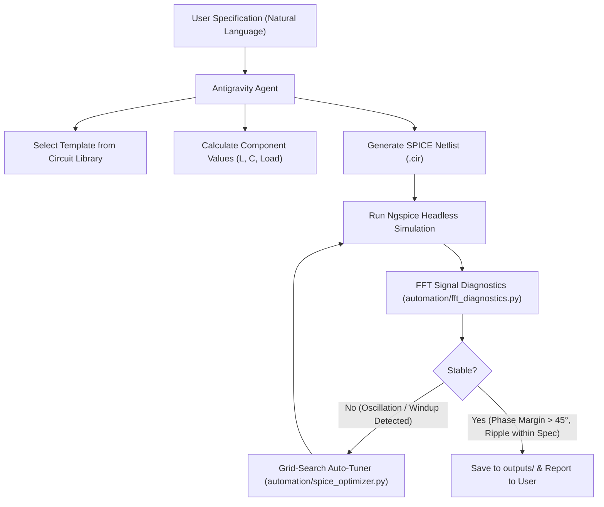

# Autonomous Power Converter Design Agent

An Agentic AI system for autonomous synthesis, simulation, and algorithmic verification of switch-mode power electronic converters using **Google Antigravity** and **Ngspice**.

---

## Overview

Unlike standard LLMs that generate plausible-looking but physically unverified SPICE netlists, this system operates as a closed-loop engineering agent. It:
1. Translates natural language specifications into physics-based component calculations.
2. Injects parameters into verified topological templates from a curated **Circuit Library** (Buck, Boost, SEPIC, LLC, Vienna Rectifier, DAB, etc.).
3. Executes automated headless simulations in **Ngspice**.
4. Analyzes output signals in the frequency domain using automated **FFT Diagnostics** (`automation/fft_diagnostics.py`) to detect loop instability, PI windup, or LC tank resonances.
5. Autonomously re-tunes controller gains ($K_p, K_i$) via grid-search optimization (`automation/spice_optimizer.py`) if instability is detected.
6. Delivers verified, simulation-ready `.cir` netlists and publication-ready diagnostic plots in the `outputs/` directory.

---

## Prerequisites

1. **Google Antigravity IDE**: Installed on your system to interact with the agent.
2. **Ngspice**: Ngspice must be installed and added to your system `PATH` (e.g. typing `ngspice --version` in terminal returns the version).
3. **Python 3.10+**: Used for mathematical calculations, FFT signal diagnostics, and parameter optimization.

---

## Installation & Setup

1. **Clone the repository**:
   ```bash
   git clone <repository-url>
   cd <repository-folder>
   ```

2. **Install Python dependencies**:
   ```bash
   pip install -r requirements.txt
   ```
   *(Required packages: `numpy`, `scipy`, `matplotlib`)*

---

## How to Test and Run (Step-by-Step)

You do **not** need to execute any manual Python runner scripts. The entire design and verification lifecycle is driven autonomously by the Antigravity Agent.

### Step 1: Open the Project in Antigravity
Launch Google Antigravity and open this repository folder (**File > Open Folder...**).

### Step 2: Open the Chat Interface
Open the Antigravity chat panel. The agent will automatically detect workspace rules from `.agents/AGENTS.md` and `Instructions.txt`.

### Step 3: Enter Your Converter Specification
Type your design requirements in natural language. For example:
> *"Design a closed-loop buck converter with 120V input, 48V output, 100kHz switching frequency, and 10A load."*

Other example prompts:
> *"Design a closed-loop boost converter, 24V in, 48V out, 50kHz, 5A load."*  
> *"Synthesize a closed-loop SEPIC converter, 12V in, 24V out, 100kHz."*

---

### Step 4: CRITICAL — Granting Permissions in Antigravity
> [!IMPORTANT]
> Because Antigravity is an active agentic pair-programmer, it autonomously runs command-line tools (Ngspice batch simulations, Python FFT diagnostics, and optimizer scripts) and writes files in your workspace.
> 
> **Whenever Antigravity prompts you for tool execution or file permissions in the UI/terminal, press Enter or click "Approve" / "Allow" to grant permission.**
> 
> The agent will execute multiple steps in sequence (Simulation $\rightarrow$ FFT Analysis $\rightarrow$ Tuning if needed $\rightarrow$ Final Verification). Keeping permissions accepted allows the autonomous loop to complete without pausing.

---

## What the Agent Executes Behind the Scenes



1. **Topology Selection**: Identifies matching circuit topology from `Circuit Library/` (15+ verified converter models).
2. **Physics Calculations**: Computes duty cycle, inductor volt-second balance, and capacitor charge balance for the target specifications.
3. **Automated Simulation**: Synthesizes `.cir` netlist and runs Ngspice in background batch mode.
4. **Spectral Diagnosis**: Discards startup transients, performs FFT analysis on steady-state ripple, and isolates dominant frequencies:
   - Sub-100 Hz $\rightarrow$ PI Integrator windup.
   - 100 Hz to 5 kHz $\rightarrow$ LC tank resonance / insufficient phase margin.
   - Switching frequency harmonics $\rightarrow$ Normal PWM ripple.
5. **Auto-Tuning**: If oscillation is diagnosed, triggers a deterministic parameter sweep over $K_p$ and $K_i$ to minimize:
   $$\text{Cost} = |V_{\text{avg}} - V_{\text{target}}| + 2 \times V_{\text{ripple}(p\text{-}p)}$$
6. **Standardized Delivery**: Stores the final verified circuit and plots under `outputs/`.

---

## Output Files

All final verified artifacts are saved in the `outputs/` folder with strict naming conventions:
- **Netlist**: `outputs/<topology>_<cl|ol>_<vin>_<vout>.cir` (e.g. `outputs/buck_cl_120_48.cir`)
- **FFT Diagnostic Plot**: `outputs/<topology>_<cl|ol>_<vin>_<vout>_fft.png`
- **Bode Stability Plot**: `outputs/<topology>_<cl|ol>_<vin>_<vout>_bode.png`
- **Transient Waveform**: `outputs/<topology>_<cl|ol>_<vin>_<vout>_transient.png`

---

## Full Research Documentation

For detailed theoretical derivations, architecture comparisons across all 4 evolutionary project phases (Direct LLM $\rightarrow$ Parameter Injection $\rightarrow$ Agentic AI $\rightarrow$ Algorithmic Verification Toolkit), refer to:
📄 **[`project_research_report.pdf`](project_research_report.pdf)** included in the root directory.
